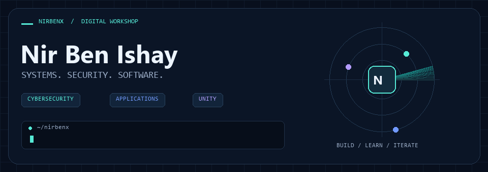
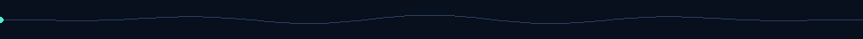
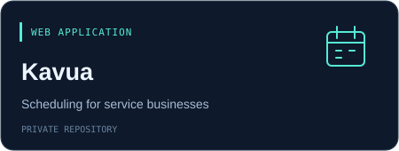
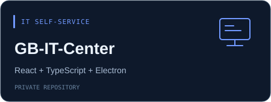
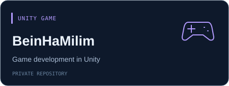
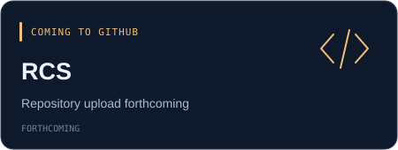

  

  
  

## Hi, I'm Nir

I build applications, explore IT infrastructure, and document hands-on cybersecurity work. My recent projects span security monitoring, appointment scheduling, IT self-service, and Unity game development.

## 01 / Security & infrastructure

### Cybersecurity Implementation & Detection Engineering Lab

[**Explore the public lab →**](https://github.com/NirBenx/cyber-implement-labs)

An enterprise-style home lab documenting network segmentation, security monitoring, and Linux endpoint detection.

- **Infrastructure:** VMware networks, FortiGate segmentation, and an Active Directory / DNS lab.
- **Monitoring:** A containerized Wazuh deployment on Ubuntu, with Auditd and file integrity monitoring.
- **Detection engineering:** Custom Wazuh rules, correlation logic, and MITRE ATT&CK mappings.
- **Documentation:** Architecture diagrams, detection runbooks, and investigation workflows, with owner-verified results distinguished from pending validation.

[Architecture](https://github.com/NirBenx/cyber-implement-labs/tree/main/architecture) · [Detection catalog](https://github.com/NirBenx/cyber-implement-labs/blob/main/docs/DETECTION_CATALOG.md)

## 02 / Applications & game development

<table>
  <tr>
    <td width="50%"></td>
    <td width="50%"></td>
  </tr>
  <tr>
    <td width="50%"></td>
    <td width="50%"></td>
  </tr>
</table>

| Project | What I'm building |
| --- | --- |
| **Kavua** | A Hebrew-first appointment scheduling and business management application for service businesses. |
| **GB-IT-Center** | An IT self-service prototype built with React and TypeScript, with a Windows desktop package using Electron. |
| **BeinHaMilim** | A game development project built with Unity. |
| **RCS** | An application project; repository upload forthcoming. |

Kavua, GB-IT-Center, and BeinHaMilim are currently in private repositories.

## 03 / Project toolkit

| Area | Technologies used in my projects |
| --- | --- |
| Security & infrastructure | Wazuh · Ubuntu / Linux · Docker Compose · Auditd · VMware · FortiGate · Active Directory |
| Applications | React · TypeScript · Next.js · NestJS · PostgreSQL · Electron |
| Games & version control | Unity · Git · GitHub |

## Let’s connect

[Find me on LinkedIn](https://www.linkedin.com/in/nir-ben-ishay-511672234/) or explore my [public repositories](https://github.com/NirBenx?tab=repositories).
